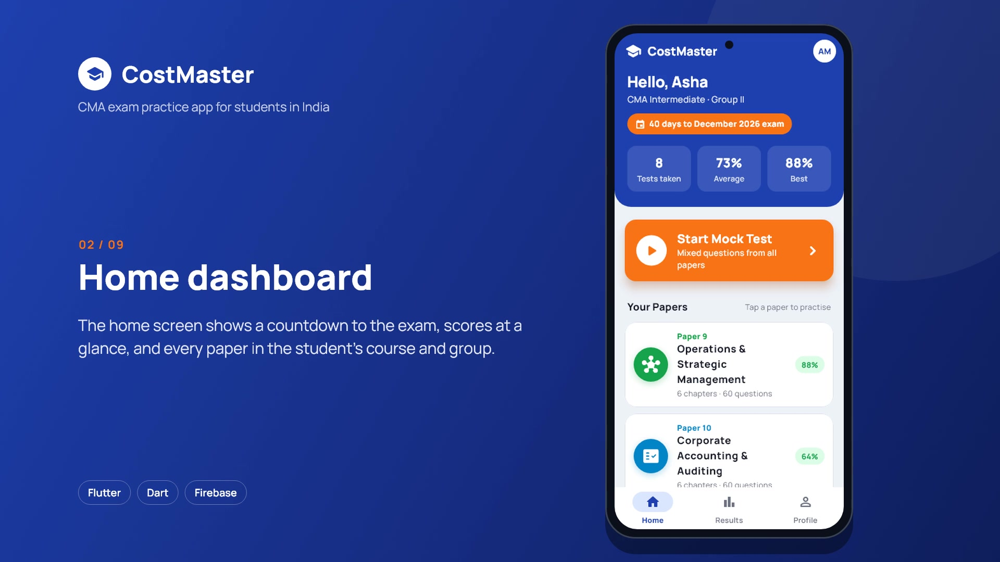
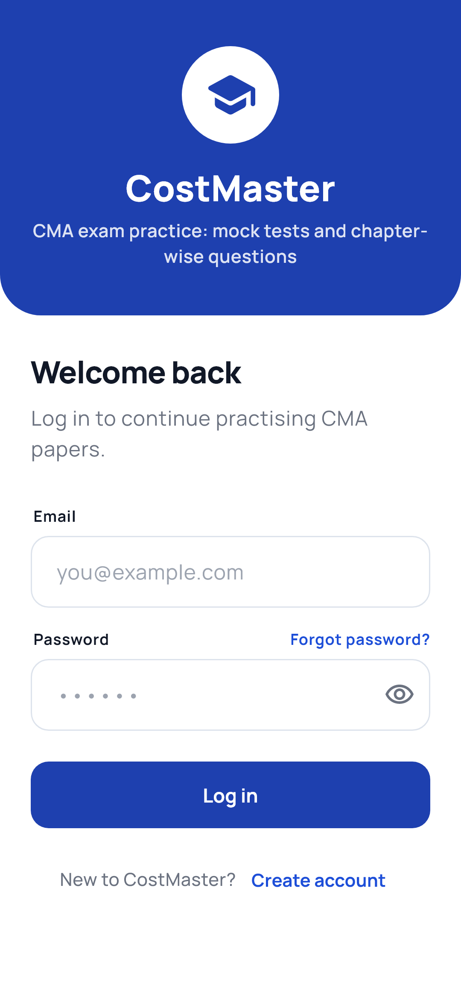
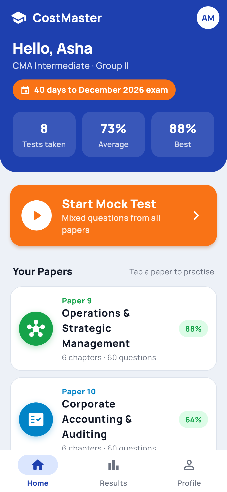
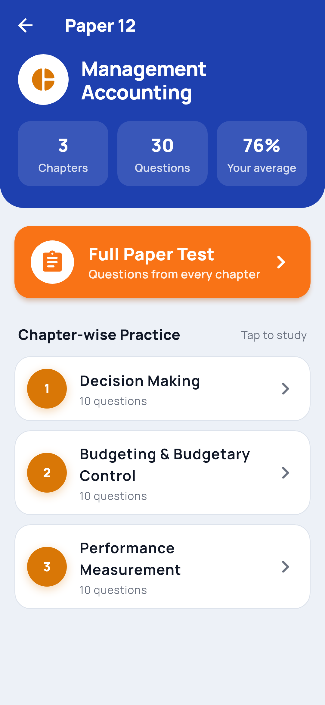
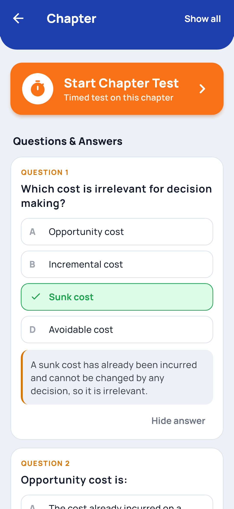
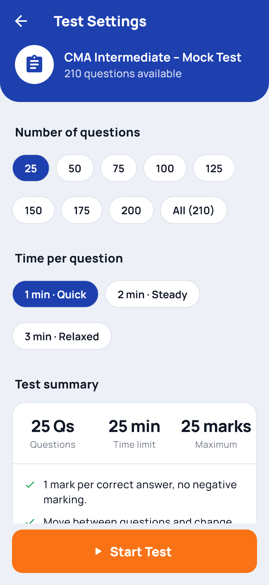
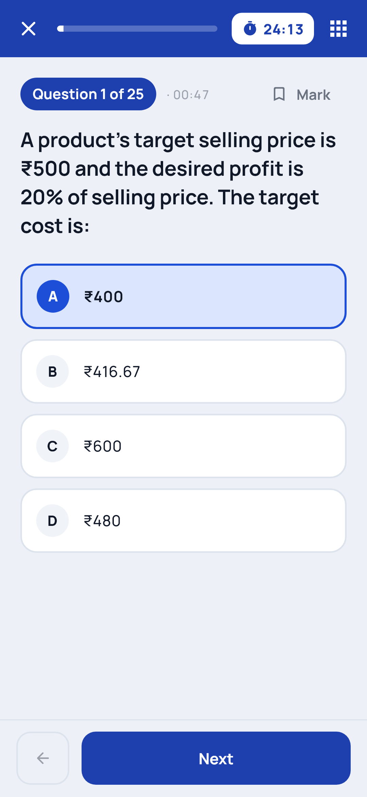
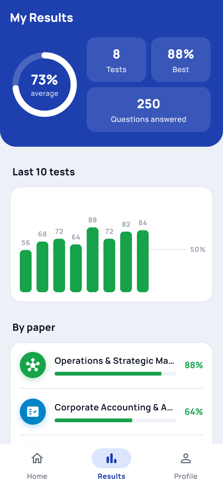
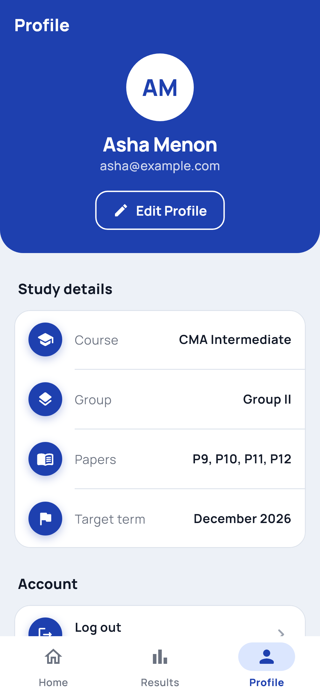
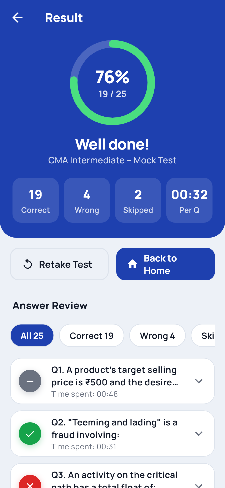

# CostMaster

A Flutter study companion for CMA India students: practice questions organised by subject, four-option MCQs and a worked explanation for every answer.

> Status: in development.

## Demo video

[](demo/costmaster-demo.mp4)

An 80-second narrated walkthrough: login, home, chapter practice, a timed
mock test, results and profile. ([Download the MP4](demo/costmaster-demo.mp4?raw=true))

## Screenshots

| Login | Home | Paper |
|:---:|:---:|:---:|
|  |  |  |
| **Chapter Q&A** | **Test settings** | **Mock test** |
|  |  |  |
| **Results** | **Profile** | **Test result** |
|  |  |  |

## Features

- Timed mock tests with a question palette, bookmarks and auto-submit
- Answer review after every test, plus average, best and per-paper results
- Countdown to the student's target exam term
- Email login with Firebase Authentication
- Practice questions grouped by subject
- Four options per question with one correct answer
- Worked explanation showing the steps for each answer
- Automated tests that check the structure of every question

## Tech

Flutter, Dart, Firebase Hosting (web build)

## Run it

```bash
flutter pub get
flutter test
flutter run
```

## Project layout

- `lib/data/questions/`: one file per subject
- `lib/data/question_bank.dart`: combines all subjects into one bank
- `tool/screenshots_test.dart`: renders `screenshots/` from the real app with
  demo data (`flutter test tool/screenshots_test.dart --update-goldens`)
- `tool/demo_video/`: builds `demo/costmaster-demo.mp4`, with the narration
  in `narration.json` (`pip install edge-tts imageio-ffmpeg`, then
  `python tool/demo_video/make_video.py`)

## Question content rules (ICMAI)

CostMaster is independent and not affiliated with or endorsed by The Institute of Cost Accountants of India (ICMAI). To stay clear of ICMAI's copyright and trademarks:

- **Write every question yourself.** Do not copy or lightly reword questions, illustrations or solutions from ICMAI study material, RTPs, MTPs or past exam papers. Use the official syllabus only to decide *which topics* to cover.
- **Don't use the ICMAI logo**, and don't describe the app as "official", "approved" or "ICMAI mock test". Keep the in-app disclaimer on the home screen.
- **Avoid content that goes stale fast.** Taxation questions depend on the Finance Act in force for each exam term. Add them only with the applicable assessment year in the question text, and review them every term.
- **Check every answer before adding it.** Each question needs exactly four options, one correct `answerIndex` and an explanation showing the working. `flutter test` checks the structure, but not that the answer is correct.

## Author

Mohammed Sajeer Cherukottayil, Flutter Developer, Dubai
